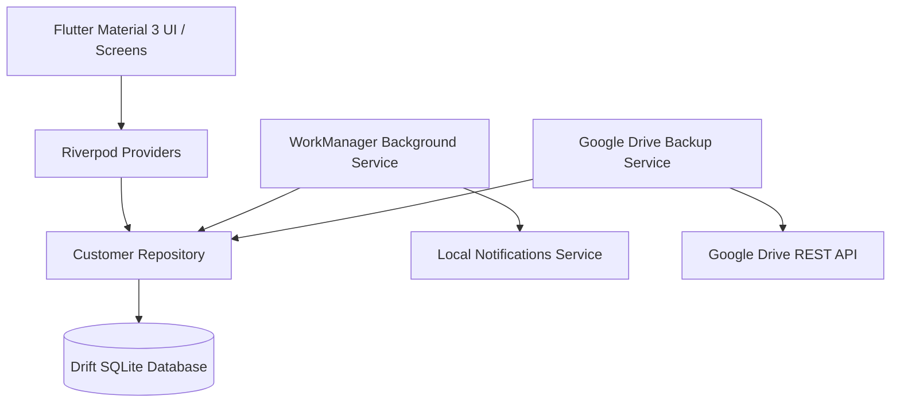

<div align="center">

  <!-- Animated Header Title -->
  

  <p align="center">
    <b>A powerful, offline-first Flutter application tailored for service professionals and maintenance businesses to track customers, log service history, receive automated overdue alerts, and sync cloud backups safely.</b>
  </p>

  <!-- Badges -->
  <p align="center">
    <a href="https://flutter.dev">
      
    </a>
    <a href="https://dart.dev">
      
    </a>
    <a href="https://developer.android.com">
      
    </a>
    <a href="https://riverpod.dev">
      
    </a>
    <a href="https://drift.simonbinder.eu">
      
    </a>
    <a href="https://www.google.com/drive/">
      
    </a>
  </p>

  <p align="center">
    <a href="#key-features">Key Features</a> •
    <a href="#architecture--tech-stack">Tech Stack</a> •
    <a href="#installation--setup">Setup</a> •
    <a href="#how-reminders-work">Reminder Logic</a> •
    <a href="#github-about-section">GitHub About Info</a>
  </p>

  <br />
</div>

---

## ⚡ Quick Overview

**Service Reminder** empowers small service businesses (water purifiers, HVAC, appliance servicing, solar maintenance, equipment repairs) to retain customers and eliminate missed service deadlines. Built with **Flutter**, **Drift (SQLite)**, and **Riverpod**, the app operates completely offline while offering optional **Google Drive Cloud Sync**.

```
📱 App Flow Overview:
┌─────────────────────────┐      ┌─────────────────────────┐      ┌─────────────────────────┐
│   Add Customer / Import │ ───► │  Set Service Interval   │ ───► │  Auto Due Calculation   │
└─────────────────────────┘      └─────────────────────────┘      └─────────────────────────┘
                                                                               │
┌─────────────────────────┐      ┌─────────────────────────┐                   ▼
│ Log Visit & Reset Date  │ ◄─── │ Ongoing Device Alert    │ ◄─── │ WorkManager Daily Check │
└─────────────────────────┘      └─────────────────────────┘      └─────────────────────────┘
```

---

## ✨ Key Features

| Feature | Description |
| :--- | :--- |
| 👥 **Customer Management** | Maintain full customer profiles including contact numbers, addresses, installation dates, and custom notes. |
| 📇 **Contacts Integration** | Quick-import customer contacts directly from your phone's address book with one tap. |
| 🔧 **Service Visit History** | Log detailed service records with dates, costs, technician notes, and serviced items. |
| 🗓️ **Smart Due Date Tracking** | Calculates next due dates dynamically using calendar-midnight accuracy to avoid timezone drift. |
| 🔔 **Background Notifications** | Daily **WorkManager** task runs in the background (survives app force-close & device reboot) to trigger persistent alerts for overdue services. |
| ☁️ **Google Drive Backup & Restore** | Privacy-focused JSON snapshot backups saved to the user's private Google Drive `AppData` space. |
| ⚙️ **Flexible Intervals** | Configure app-wide default reminder intervals (e.g., 3 months) or override per customer (e.g., 6 or 12 months). |
| 🌙 **Adaptive Material 3 Theme** | Seamless light & dark modes with custom splash screen and high-resolution app branding. |

---

## 🏗️ Architecture & Tech Stack

The application adheres to clean architecture principles with decoupled layers for data, state management, background execution, and UI components.



### Core Technologies
- **UI Framework:** [Flutter 3.41+](https://flutter.dev) / [Dart 3.11+](https://dart.dev)
- **State Management:** [Riverpod 2.6](https://riverpod.dev)
- **Database & Persistence:** [Drift 2.34](https://drift.simonbinder.eu) (SQLite ORM) & `shared_preferences`
- **Background Tasks:** [Workmanager 0.10](https://pub.dev/packages/workmanager)
- **Local Notifications:** [flutter_local_notifications 22.3](https://pub.dev/packages/flutter_local_notifications)
- **Authentication & Cloud API:** `google_sign_in` & `googleapis` (Drive `appdata` scope)
- **Contact Picker:** `flutter_contacts`

---

## 🚀 Installation & Setup

### Prerequisites
- **Flutter SDK:** `^3.41.4` (Stable channel)
- **Dart SDK:** `^3.11.4`
- **Android Studio / Android SDK:** target API level 34+ (minSdk 24)

### 1. Clone the Repository
```bash
git clone https://github.com/Murugavl/Reminder-App.git
cd Reminder-App/service_reminder
```

### 2. Install Dependencies
```bash
flutter pub get
```

### 3. Generate Database & Build Runner Code
```bash
dart run build_runner build --delete-conflicting-outputs
```

### 4. Run the Application
```bash
flutter run
```

---

## 🔐 Optional Configuration

<details>
<summary><b>1. Setting up Google Drive Backup & Sign-In (Click to Expand)</b></summary>

<br />

The core app operates 100% offline without Google credentials. To enable optional cloud backups:

1. Open [Firebase Console](https://console.firebase.google.com/) and create a project.
2. Enable **Google Drive API** in Google Cloud Console for the project.
3. Register an Android app with package name `com.servicereminder.service_reminder`.
4. Add your **debug SHA-1** fingerprint (`keytool -list -v -keystore ~/.android/debug.keystore`) and release SHA-1 to the Firebase app settings.
5. Download `google-services.json` and place it in `service_reminder/android/app/google-services.json`.

> ⚠️ **Note:** `google-services.json` is gitignored for security.

</details>

<details>
<summary><b>2. Configuring Release Build Signing (Click to Expand)</b></summary>

<br />

1. Generate your keystore file:
   ```bash
   keytool -genkey -v -keystore ~/service-reminder-release.jks -keyalg RSA -keysize 2048 -validity 10000 -alias service_reminder
   ```
2. Copy `android/key.properties.example` to `android/key.properties`:
   ```bash
   cp android/key.properties.example android/key.properties
   ```
3. Update the property values with your keystore path and credentials.
4. Build the release APK or AAB:
   ```bash
   flutter build apk --release
   flutter build appbundle --release
   ```

</details>

---

## 🧠 How Reminders & Backup Work

### Reminder Engine
- **Due Date Calculation:** Each customer has a `next_due_date` calculated as `(Last Service Date OR Installation Date) + (Reminder Interval)`.
- **Calendar Accuracy:** All dates are stored as UTC-midnight values (`YYYY-MM-DD`) to eliminate timezone shift bugs when traveling across timezones.
- **Persistent Notifications:** WorkManager runs a daily background check (~24h period). Overdue customers receive non-swipeable (`ongoing`) notifications until a service visit is logged. Tapping the alert opens the customer's detail screen directly.

### Backup Engine
- **Privacy First:** Drive integration relies on the restricted `drive.appdata` scope, giving the app zero visibility or access to any other files in the user's Google Drive.
- **Snapshot Export:** Exports all customer profiles and service history into timestamped JSON files (`service_reminder_backup_<timestamp>.json`).
- **Silent Weekly Backup:** Optional background schedule automatically syncs local database snapshots weekly when connected to Wi-Fi.

---

## 📂 Project Structure

```
service_reminder/
├── android/               # Android native configuration & manifests
├── assets/                # App icons, splash images, and launcher graphics
├── lib/
│   ├── data/              # Drift DB schema, tables, and CustomerRepository
│   ├── models/            # Value objects & due status logic (Overdue/Due Soon)
│   ├── providers/         # Riverpod providers & dependency injection
│   ├── screens/           # UI screens (Home, Details, Settings, Restore)
│   ├── services/          # WorkManager dispatcher, Notifications, Backup service
│   └── widgets/           # Reusable UI widgets & forms
├── test/                  # Unit and widget test suite
└── pubspec.yaml           # Flutter package dependencies and metadata
```

---

## 🌟 GitHub "About" Section Copy-Paste

Use the following snippets to fill in your GitHub repository **About** sidebar:

### 📝 Short Description (Paste in GitHub Description box)
> 📱 A Flutter app for small service businesses to manage customers, track service history, receive automated background overdue reminders, and perform secure Google Drive backups.

### 🏷️ Recommended Repository Topics (Paste in GitHub Topics box)
`flutter` `dart` `drift-db` `riverpod` `service-reminder` `customer-management` `workmanager` `google-drive-backup` `android-app` `sqlite` `material-3`

---

<div align="center">
  <sub>Built with ❤️ using <b>Flutter & Dart</b>. Designed for small business reliability.</sub>
</div>
